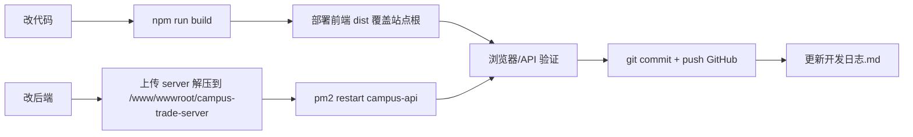

# 文衡 · 校园二手书籍交易平台

> 文聚学府，百事通达 —— 学生 · 书友 · 校园交易平台

一个面向校园场景的二手书交易全栈项目，包含 **Web 前端（Vue 3 + Vite）**、**后端 API（Express + MySQL）** 与 **Android App（Capacitor 内嵌打包）**，并深度集成 **AI 能力**（扫码识别书籍、AI 助手对话、OCR 书单导入）。

在线地址：`http://121.40.219.139`（宝塔面板 + Nginx + PM2 部署）

---

## 一、系统架构

```
┌──────────────────────────── 用户访问层 ────────────────────────────┐
│  PC 浏览器 (Web PWA)          │          Android App (Capacitor 内嵌) │
└──────────────────────────────┬──────────────────────────────────────┘
                               │ HTTP
┌──────────────────────────────▼──────────────────────────────────────┐
│                 Nginx（宝塔面板，站点 121.40.219.139）                 │
│   ├─ /              → 静态前端（web/dist，SPA fallback → index.html）  │
│   ├─ /assets|icons  → 前端构建产物（含 PWA manifest / sw.js）          │
│   ├─ /api/          → 反向代理 → 127.0.0.1:3000/api/                  │
│   └─ /uploads/      → 反向代理 → 127.0.0.1:3000/uploads/（图片）       │
└──────────────────────────────┬──────────────────────────────────────┘
                               │
┌──────────────────────────────▼──────────────────────────────────────┐
│          后端 API 服务（Express · ESM · PM2 进程 campus-api）          │
│   端口 3000 │ JWT 鉴权 │ CORS 全开 │ Sequelize ORM │ multer 上传       │
│   ├─ routes/    15 个业务路由模块（auth/books/orders/agent...）        │
│   ├─ controllers/   业务逻辑控制器                                    │
│   ├─ services/      AI / OCR / ISBN / 邮件 等外部能力封装              │
│   └─ middlewares/   auth(401) / admin(403) / errorHandler             │
└──────────────┬─────────────────────────────────┬─────────────────────┘
               │                                 │
┌──────────────▼──────────────┐   ┌──────────────▼─────────────────────┐
│   MySQL（campus_trade）      │   │   外部能力（AI 相关）                │
│   16 张表（Sequelize sync）   │   │   ├─ SiliconFlow 视觉模型（扫码识别） │
│   users/products/orders...   │   │   ├─ 百度 OCR（书单图片解析）        │
└─────────────────────────────┘   │   ├─ OpenLibrary / Google Books     │
                                  │   └─ SMTP 邮件（验证码/找回密码）      │
                                  └────────────────────────────────────┘
```

**请求链路示例**（Web 端）：
`浏览器 → Nginx(80) → /api/auth/login → Express:3000 → MySQL`，前端构建产物内的 API 前缀为 `/api`（同源，走 Nginx 反代，无跨域问题）。

**Android App 差异**：Capacitor 将 `web/dist` 内嵌为本地资源，`web/.env.production` 使用绝对地址 `http://121.40.219.139:3000/api` 直连后端（CORS 全开，可跨域）。

---

## 二、技术栈

| 端 | 技术 |
| --- | --- |
| Web 前端 | Vue 3 · Vite 5 · Pinia · Vue Router 4 · Element Plus · Axios · vue-i18n（中/英） |
| Android | Capacitor 8（`@capacitor/android` · app · status-bar），内嵌本地资源打包 |
| PWA | manifest.json + Service Worker（sw.js，导航 network-first / 静态资源 cache-first） |
| 后端 | Node.js · Express 4（ESM）· Sequelize 6 · mysql2 · JWT · bcryptjs · multer · sharp · nodemailer |
| AI/OCR | SiliconFlow 视觉模型（扫码识别书籍）· 百度 OCR（书单解析）· OpenLibrary/Google Books（ISBN 查书） |
| 部署 | 宝塔面板 · PM2 · Nginx 反向代理 · MySQL 5.7/8.0 |

---

## 三、目录结构

```
campus-trade/
├── web/                        # Web 前端 + Android 工程
│   ├── src/
│   │   ├── api/                # API 封装（request.js 拦截器 + 各业务模块）
│   │   ├── assets/styles/      # 全局样式
│   │   ├── components/         # 公共组件（NavBar/TabBar/BottomNav/AiFloat/ProductCard）
│   │   ├── i18n/               # 国际化（zh.js / en.js，新文案必须双语同步）
│   │   ├── router/             # 路由 + 登录守卫（auth/admin 两级）
│   │   ├── stores/             # Pinia（user 登录态 / agent AI 会话）
│   │   └── views/              # 页面（Login/ForgotPassword/Home/Trade/... 共 15 页）
│   ├── public/                 # manifest.json + sw.js（PWA）
│   ├── dist/                   # 构建产物（生产部署的就是它）
│   ├── android/                # Capacitor Android 工程（gradle 构建 APK）
│   ├── capacitor.config.json   # App 打包配置
│   ├── .env.development        # 开发环境（VITE_API_BASE=/api，proxy 到远端）
│   ├── .env.production         # 生产环境（Android 直连绝对地址）
│   └── vite.config.js          # 构建 + dev proxy 配置
├── server/                     # 后端 API
│   ├── src/
│   │   ├── app.js              # 入口：中间件、路由挂载、启动、定时任务
│   │   ├── config/database.js  # Sequelize 连接
│   │   ├── models/             # 16 张表的 ORM 模型
│   │   ├── routes/             # 15 个路由模块
│   │   ├── controllers/        # 业务控制器
│   │   ├── services/           # agentService / aiService / ocrService / isbnService / emailService
│   │   ├── middlewares/        # auth(401) / admin(403) / errorHandler
│   │   ├── scripts/            # init-db.js 数据库初始化
│   │   ├── utils/              # upload.js / response.js / imageDownload.js
│   │   └── uploads/            # 上传的图片文件（/uploads 静态服务）
│   └── deploy/                 # 后端部署说明.md（宝塔部署教程）
├── 开发日志.md                 # 全量开发日志（36 节 + 提交记录表 + 问题汇总表）
├── 队友快速上手手册.md         # 给协作者的完整上手手册
├── 安卓App打包说明.md          # Android APK 打包教程
├── serve.js / start-preview.bat # 本地静态预览辅助
└── README.md
```

---

## 四、核心功能

- **卖/买双 Tab 交易市场**：交易页可切换「我要卖 / 我要求购」，两种场景各自独立流程
- **扫码识别上架（AI）**：拍照 → **正面识别一次 + 背面 ISBN 再识别一次** → 自动填充书名/作者/出版社/定价等 → 弹出核对弹窗 → 识别照片自动作为封面（可后改）→ 识别后如有同 ISBN 在售/求购，自动罗列到筛选面板（可按书名/ISBN/价格筛选）
- **AI 助手**：站内智能助手（AiFloat 悬浮窗，可开/关），支持多轮记忆（localStorage 持久化，切页不丢）、界面跳转按钮/链接、中英双语回复
- **账号体系**：邮箱注册/登录、8 位学号、**忘记密码（邮箱验证码自助找回）**、管理后台（管理员专属）
- **书单智能导入**：上传书单图片 → OCR + AI 解析 → 一键加入购物车
- **交易闭环**：购物车、订单、求购清单、收藏、站内聊天（会话合并、过期清理）
- **首页**：书籍瀑布流、热点/公告、分类导航、个人中心
- **国际化**：全站中英文切换（zh.js / en.js 双语资源）
- **PWA + Android**：可"添加到主屏幕"；Android APK 内嵌打包，API 直连远程

---

## 五、快速开始（本地开发）

### 1. 后端

```bash
cd server
npm install
# 复制 .env.example 为 .env 并填写配置（见下方环境变量表）
npm run db:init     # 初始化数据库表
npm run dev         # 启动 API，默认 http://localhost:3000
```

### 2. 前端

```bash
cd web
npm ci --ignore-scripts   # 跳过 esbuild postinstall（Windows 杀软可能拦截）
npm run dev               # 启动 Vite dev server，默认 http://localhost:5173
```

- dev server 已配置 proxy：`/api` → `http://121.40.219.139:3000`（见 `.env.development` / `vite.config.js`）
- 若 esbuild 被安全软件拦截：用 `node node_modules/vite/bin/vite.js build` 直接构建

### 3. 验证

浏览器访问 `http://localhost:5173`；后端健康检查 `curl http://localhost:3000/api/health` → `{"code":0,"message":"ok"}`

---

## 六、环境变量

### 后端 `server/.env`

| 变量 | 说明 |
| --- | --- |
| `PORT` | API 端口，默认 3000 |
| `DB_HOST / DB_PORT / DB_NAME / DB_USER / DB_PASSWORD` | MySQL 连接（库名 `campus_trade`，编码 utf8mb4） |
| `JWT_SECRET / JWT_EXPIRES` | 登录令牌密钥与有效期 |
| `MAIL_HOST / MAIL_PORT / MAIL_USER / MAIL_PASS` | SMTP 邮件（发送验证码、找回密码） |
| `AI_API_KEY / AI_API_URL / AI_MODEL` | SiliconFlow 视觉模型（扫码识别书籍，当前 Qwen3-VL-8B） |
| `BAIDU_OCR_API_KEY / BAIDU_OCR_SECRET_KEY` | 百度 OCR（书单图片解析） |
| `OPEN_LIBRARY_URL / GOOGLE_BOOKS_URL` | ISBN 查书接口地址 |
| `MAX_FILE_SIZE` | 上传大小限制 |

> 未配置 AI Key 时：书单解析走内置兜底逻辑，ISBN 查书仍可用免费接口。

### 前端 `web/.env.*`

| 文件 | 变量 | 说明 |
| --- | --- | --- |
| `.env.development` | `VITE_API_BASE=/api` | 本地 dev 走 vite proxy |
| `.env.development` | `VITE_API_TARGET=http://121.40.219.139:3000` | proxy 目标 |
| `.env.production` | `VITE_API_BASE=http://121.40.219.139:3000/api` | **Android 打包直连用**；Web 部署构建时用环境变量覆盖回 `/api` |

---

## 七、API 概览（前缀 `/api`）

| 前缀 | 功能 | 鉴权 |
| --- | --- | --- |
| `/api/auth` | 注册、登录、发送验证码、忘记密码（send-reset-code / reset-password）、获取当前用户 | 部分 |
| `/api/books` · `/api/book` · `/api/products` | 书籍/商品查询、发布、上下架、详情 | 写操作需登录 |
| `/api/cart` | 购物车 | 登录 |
| `/api/orders` | 订单（含买家/卖家视图） | 登录 |
| `/api/wishlist` | 求购清单（含扫码识别创建） | 登录 |
| `/api/favorites` · `/api/book-favorites` | 收藏 | 登录 |
| `/api/conversations` · `/api/messages` | 站内聊天（会话 + 消息） | 登录 |
| `/api/notifications` | 通知 | 登录 |
| `/api/hotspots` | 首页热点/公告 | 读公开 |
| `/api/agent` | **AI 助手对话（多轮记忆、界面跳转）** | 登录 |
| `/api/admin` | 管理后台 | admin |
| `/uploads` | 上传图片静态访问 | 公开 |

认证方式：`Authorization: Bearer <JWT>`；未带/失效 → 401；管理员接口无 admin 权限 → 403。

---

## 八、数据库（16 张表）

`users`（含 userNo 学号）、`hotspots`、`categories`、`products`（书 + 商品信息）、`product_images`、`cart_items`、`orders`、`order_items`、`favorites`、`messages`、`wishlists`、`notifications`、`books`（书籍库）、`book_favorites`、`conversations`、`chat_messages`

> 表结构由 Sequelize `sync({ alter: true })` 启动时自动维护；字段命名 `snake_case`（`user_no`、`created_at` 等）。

---

## 九、部署（生产环境）

详见 `server/deploy/后端部署说明.md` 与 `队友快速上手手册.md`。核心闭环：



**前端部署**（宝塔）：打包 `web/dist` → 上传解压到站点根 `/www/wwwroot/121.40.219.139/`（`--strip-components=1`）→ 刷新验证。

**后端部署**：上传 `server/` → `/www/wwwroot/campus-trade-server/` → `pm2 restart campus-api`。

**Nginx 关键配置**（站点 → 伪静态/反代）：

```nginx
location /api/ {
  proxy_pass http://127.0.0.1:3000/api/;
  proxy_set_header Host $host;
  proxy_set_header X-Real-IP $remote_addr;
  proxy_set_header X-Forwarded-For $proxy_add_x_forwarded_for;
}
location ^~ /uploads/ {
  proxy_pass http://127.0.0.1:3000/uploads/;   # 必须带 ^~，否则被图片静态规则劫持 404
}
```

---

## 十、协作规范

- **Git 流程**：每天收尾必须 `git commit` + `push origin main` + 更新 `开发日志.md`；新文案必须 `zh.js` / `en.js` 双语同步
- **以 GitHub 为唯一基准**：本地冲突时以 `origin/main` 为准回滚，再合并队友改动
- **文档**：开发日志（按节记录 + 提交记录表 + 问题汇总表）、队友快速上手手册、安卓 App 打包说明
- **验证铁律**：改完代码必须走完整闭环（构建 → 部署 → 验证 → 提交），**线上运行的必须是 GitHub 源码构建的产物**（历史教训：线上旧构建导致"忘记密码跳转"等诡异 bug）

---

## 十一、里程碑

| 版本 | 内容 |
| --- | --- |
| v1 | 基础框架：登录注册、首页、商品发布、购物车、订单、聊天 |
| v2 | AI 能力：书单 OCR 导入、ISBN 查书、AI 助手（多轮记忆/跳转/悬浮窗）、扫码识别上架 |
| v3 | 交易升级：卖/买双 Tab、求购清单、两步扫码识别 + 核对弹窗 + 封面可改 + 同书筛选 |
| v4 | 账号安全：邮箱找回密码、中英文国际化全站覆盖、PWA、Android App 内嵌打包 |
